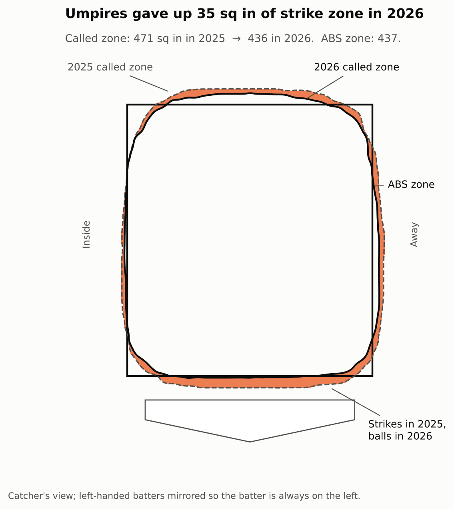
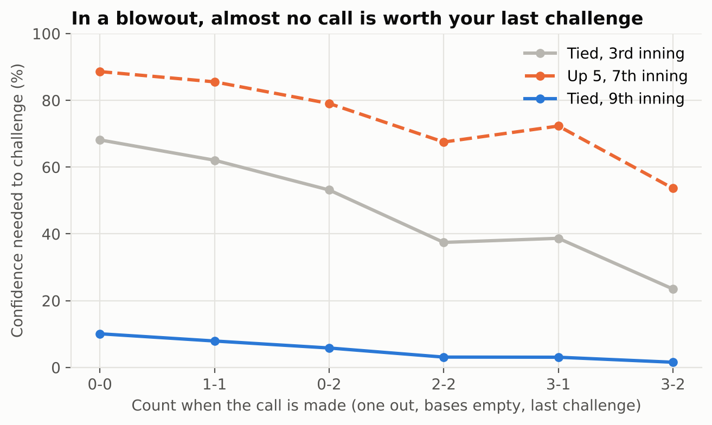
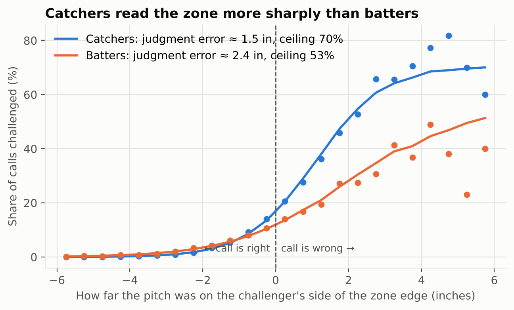
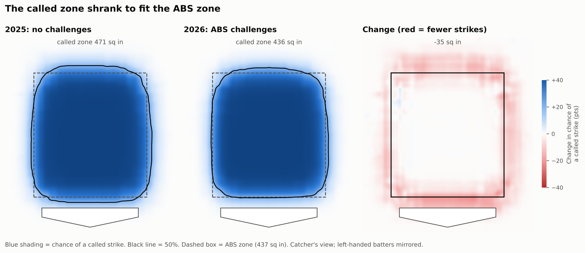
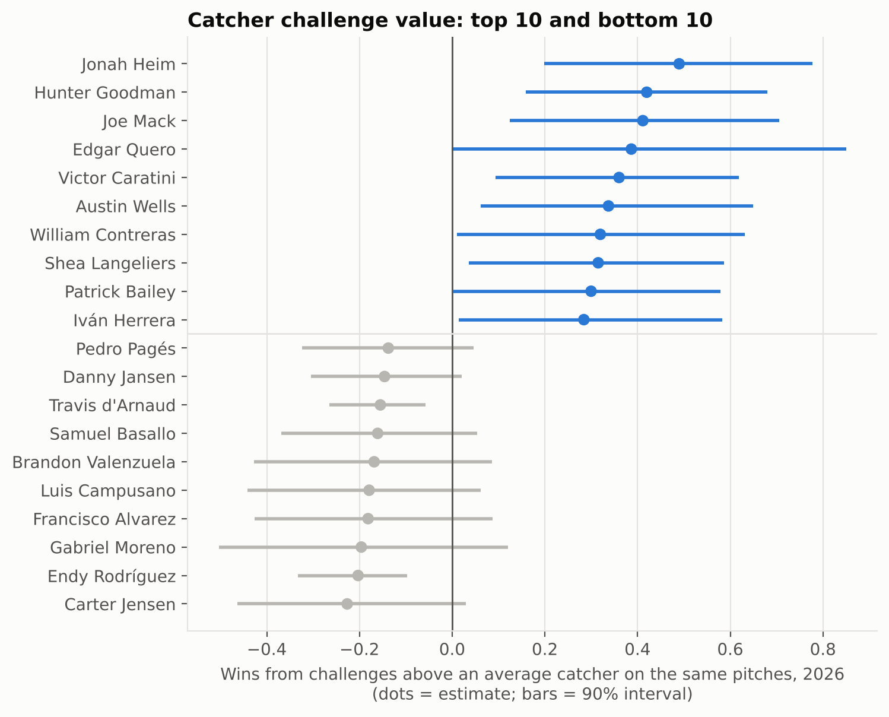
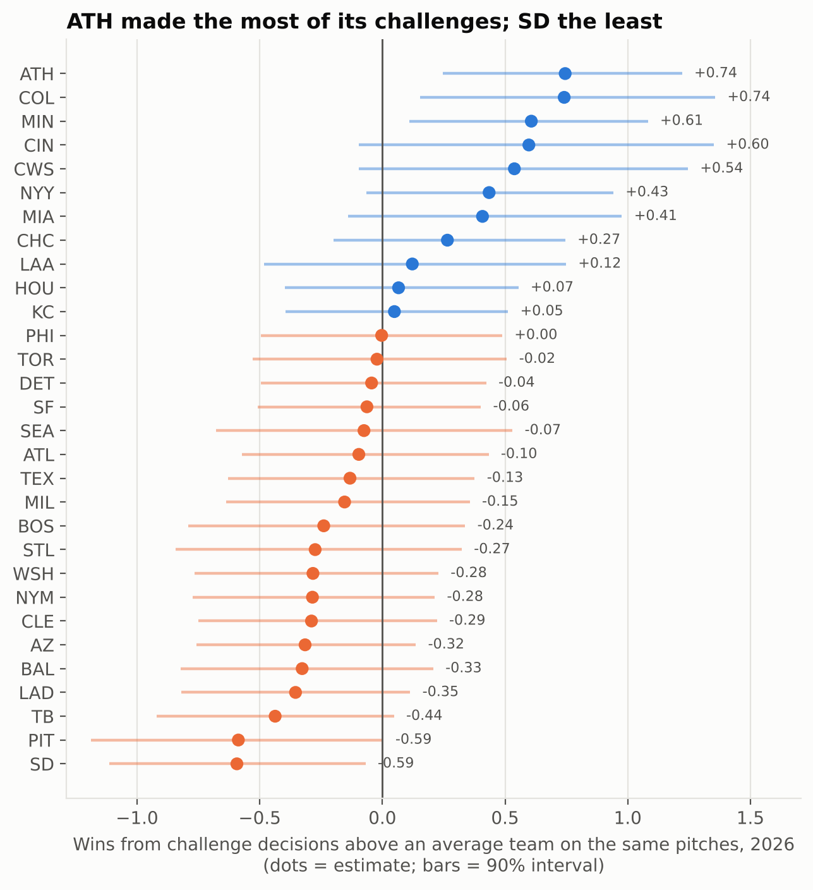
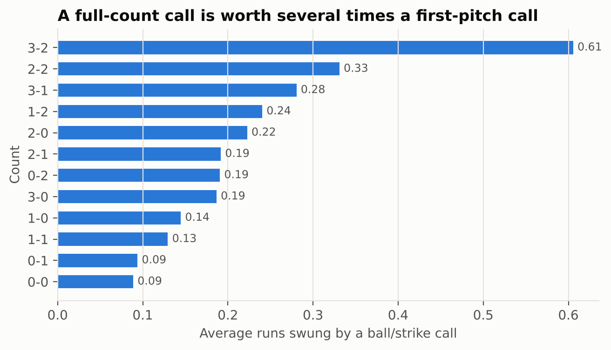

# The ABS Effect: The Shrinking Strike Zone and When a Challenge Is Worth Making

**Jordan Salter** · M.S. Statistics, University of Southern California · October 2026

An analysis of all 1.42 million pitches from the 2025–26 MLB regular seasons and all 10,546 challenges from 2026, the first season of the Automated Ball-Strike (ABS) challenge system. It asks two questions: how did umpires change once their calls could be overturned, and when should a team actually challenge?

**Methods:** reconciling a measurement change across two data sources · gradient-boosted classification with game-level bootstrap inference · logistic win-probability modeling · a maximum-likelihood psychometric model with a lapse rate · a fixed-point Monte Carlo simulation of 2,429 games · decision analysis under uncertainty. Python (pandas, NumPy, scikit-learn, SciPy, matplotlib).

**Start here:** [`notebooks/quickstart.ipynb`](notebooks/quickstart.ipynb) loads the data and reproduces two headline results in a few cells.

## Key findings

- **The called zone shrank to fit the ABS zone.** It went from 471 to 436 square inches (−35, 95% CI −40 to −29), against an ABS zone of 437. The change is a thin ring just outside the zone, largest at the bottom edge. The corners are still called tight, so balls called on in-zone pitches *rose* from 8.1% to 10.1%.
- **Catcher framing lost ~44% of its spread.** The SD of framing value fell from 9.4 runs to 5.3, so a framing-first catcher is worth much less on the market.
- **The score matters as much as the count, and players ignore it.** A close-and-late call is worth 12× the same call in a blowout (3.7% vs. 0.3% win probability). Players' challenge rates respond to the count and the inning, but not to the score.
- **Teams leave ~1.5 wins each on the table.** A season-long simulation with a self-consistent value for a saved challenge shows the best policy adds about 1.5 wins per team. Most of that comes from acting on calls players can already see are wrong (batters act on only 53%), not from better thresholds (+0.25). The best policy wins *fewer* challenges (46% vs. 55%), so **overturn rate is the wrong metric** for judging challengers.

<table>
<tr>
<td width="50%"></td>
<td width="50%"><br><br></td>
</tr>
<tr>
<td><sub>The 2025 called zone (dashed) spilled past the ABS box. The 2026 zone (solid) sits on it, and the orange band was a strike in 2025 and a ball in 2026.</sub></td>
<td><sub><b>Top:</b> confidence needed to spend your last challenge, by count and game situation. <b>Bottom:</b> catchers judge location with ~1.5 in of error vs. ~2.4 for batters, and act on what they see 70% vs. 53% of the time.</sub></td>
</tr>
</table>

## How it works

1. **Two seasons on one scale.** In 2026 Statcast moved pitch location from the front to the middle of the plate. I moved every 2025 pitch along its tracked trajectory to the mid-plate point (about 1 inch lower), and gave every batter one fixed ABS zone in both seasons. I also flipped 2026 overturns back to the umpire's original call.
2. **Called-zone model.** A gradient-boosted P(strike | location) for each season. Zone size is the area where P ≥ 0.5, with a game-level bootstrap interval.
3. **Win-probability stakes.** A logistic WP model by inning and half-inning (calibrated within 1.5 points; r = 0.996 with Savant's win expectancy) values every call as WP(after a ball) − WP(after a strike).
4. **Perception model.** A psychometric function with a lapse rate, fit to 341,624 challenge opportunities. Its slope gives each role's effective judgment error, and its ceiling gives how often players act on what they see.
5. **Simulated option value.** I replayed all 2,429 games under a policy, re-estimated the value of a saved challenge, and repeated until the policy and the value agreed. Break-even confidence = OV / (stake + OV).
6. **Players and teams.** Value above an average player on the same pitches, with bootstrap intervals and a split-half reliability check.

Every modeling decision and its alternatives are written up in [`METHODS.md`](METHODS.md).

**Validation.**
- Zone geometry reproduces 99.7% of official challenge outcomes.
- Fielder challenge totals match Savant's (5,784 vs. 5,792, both 58% overturned).
- The actual-policy simulation reproduces real challenge volume (2.14 vs. 2.13 per team-game).
- Jose Altuve ranks as the top batter, and William Contreras and Patrick Bailey are among the top 10 catchers, matching published 2026 rankings.

## More figures

<table>
<tr>
<td colspan="2"><br><sub>Chance of a called strike in 2025 and 2026, and the change between them. Strikes vanished just outside the box; nothing changed inside it.</sub></td>
</tr>
<tr>
<td width="50%"><br><sub>Catcher decision value with 90% intervals. Split-half reliability is low (r ≈ 0.14), so one season is a starting point for scouting, not a verdict.</sub></td>
<td width="50%"><br><sub>Team value from challenge decisions above an average team. Only 4 of 30 teams are distinguishable from average after one season.</sub></td>
</tr>
<tr>
<td colspan="2" align="center"><br><sub>A 3-2 call swings 0.61 runs; a 0-0 call swings 0.09.</sub></td>
</tr>
</table>

## Repository

```
notebooks/        quickstart.ipynb: load the data and reproduce two results
data/processed/   analysis-ready data: 740k called pitches, 10.5k challenges, 342k opportunities (see data/README.md)
src/              fetch → build → model → figures, all in Python
tools/            builds the quickstart notebook
results/          every headline number (results.json, part2/results_part2.json) and the tables behind each figure
figures/          the figures above; figures/extra/ has earlier versions and supplementary charts
METHODS.md        each modeling decision, the alternatives, and the caveats
```

**Reproduce:** `pip install -r requirements.txt`, then `bash run_all.sh`. It pulls the raw data from Baseball Savant (~1 hour the first time, cached afterward), then rebuilds every dataset, result and figure.

**Limitations.** Judgment error is inferred from decisions, so it's per role, not per player. The simulation holds the 2026 pitch sequence fixed, so it doesn't model pitchers or hitters adapting. Extra innings are excluded. One season can't separate individual skill from luck.

<sub>Data: Baseball Savant / MLB Advanced Media. Not affiliated with MLB.</sub>
